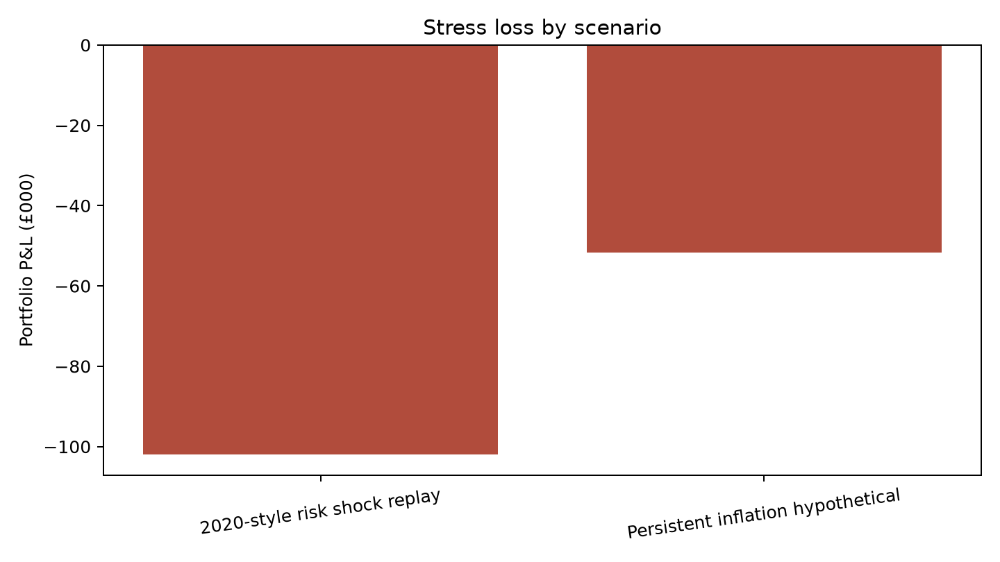

# Investment Controls · Batch 02

> Six reproducible systems that turn investment data into decisions, reconciliations and reviewable controls.

This repository follows an investment process from information timing to mandate oversight. It demonstrates the failure modes that matter in practice: revised data leaking into a backtest, an unlicensed dataset passing review, replayed payment events, linear risk applied to an option, unexplained active return, and alerts driven by stale positions.

[](https://github.com/ambekarhrush/investment-controls-batch-02/actions/workflows/quality.yml)



## What the demonstrations prove

| Project | Decision supported | Verified demo result |
| --- | --- | --- |
| [45 · Point-in-time data](projects/45-point-in-time-dataset/) | What was knowable when a decision was made? | A bitemporal join catches 2 future-data leaks |
| [47 · Data catalogue](projects/47-data-catalogue/) | Can this dataset be used, and what breaks if it changes? | 1 of 4 datasets is blocked; 2 consumers are traced |
| [48 · Payment reconciliation](projects/48-payment-reconciliation/) | Did cash settle once and post correctly? | 1 duplicate is ignored; ledger balances; £75 break found |
| [03 · Stress testing](projects/03-stress-testing/) | Where does the portfolio lose under coherent shocks? | 2 scenarios; 1 option fully repriced |
| [04 · Brinson attribution](projects/04-brinson-attribution/) | Why did the portfolio beat its benchmark? | 60 bp active return reconciles to machine precision |
| [06 · Mandate monitoring](projects/06-mandate-monitoring/) | Which limits need action now? | 2 new, 2 acknowledged and 2 resolved breaches; stale input suppressed |

The figures above come from committed synthetic fixtures and generated artifacts, not production performance. Each summary includes its as-of date and a SHA-256 input fingerprint.

## Quick start

Requires Python 3.11+ and [`uv`](https://docs.astral.sh/uv/).

```bash
uv sync --extra dev --locked
uv run investment-controls all
uv run pytest -q
```

Open [`outputs/batch-report.html`](outputs/batch-report.html) for the integrated evidence view. Individual commands are also available:

```bash
uv run investment-controls point-in-time
uv run investment-controls catalogue
uv run investment-controls payments
uv run investment-controls stress
uv run investment-controls attribution
uv run investment-controls mandates
```

## Design

Each project owns its inputs and outputs; Python modules contain the reusable logic. The batch report reads a small shared `summary.json` contract, so adding another control does not require changing existing engines. See [batch design](docs/BATCH_PLAN.md), [fixture provenance](docs/FIXTURES.md), and [shared contracts](shared/contracts/).

Quality checks run the complete pipeline before linting, static analysis and tests. No API key or vendor data is required.

## Repository map

```text
projects/<id>/data/fixtures/    inspectable synthetic inputs
projects/<id>/outputs/demo/     generated evidence
src/investment_controls/        modular engines and CLI
tests/                          invariant and reconciliation tests
outputs/                        integrated report and manifest
```

MIT licensed. Built as a portfolio demonstration; methods and limitations are documented within each project.
