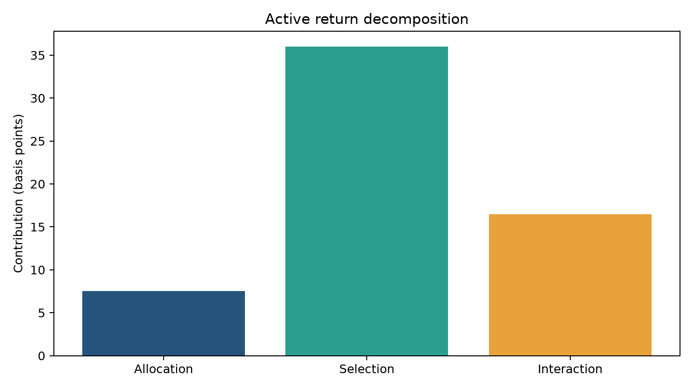

# Brinson performance attribution

Active return becomes actionable when it is decomposed into allocation, selection and interaction effects. This module implements arithmetic Brinson-Fachler attribution by sector and checks the result against portfolio minus benchmark return.



## Demonstrated result

The synthetic portfolio returns 3.02% against 2.42% for its benchmark. The resulting **60 bp active return** reconciles to the sum of attribution effects with an error below `1e-12`.

```bash
uv run investment-controls attribution
```

Review [sector-level effects](outputs/demo/sector_attribution.csv) and the [summary](outputs/demo/summary.json). Returns are single-period and arithmetic; multi-period linking, fees, cash flows and currency effects remain outside this demonstration.
